<!-- _class: title -->
<!-- _paginate: false -->

# CS 487: Building Secure Computer Systems

## AI for Security

### Fall 2026

Kenan Alghythee
University of Illinois Chicago

<!--
75 minutes. Three hands-on stations are built in lab/. Pick on the day which
ones students drive (Station 1 is the default) and which you demo.
Hand out the class key at the Station 1 slide, not before. Figures regenerate
with python3 slides/figures/make_figures.py.
-->

---

## About me

**Kenan Alghythee** · 3rd-year PhD student, University of Illinois Chicago

**Research:** systems software security and OS security · AI security · software engineering and program analysis

**Most of my work:** using AI for security, targeting automatic vulnerability repair and verification, and vulnerability detection

<!-- Keep this under a minute. -->

---

## Why this lecture: the humans are not keeping up

<div class="cols">
<div>

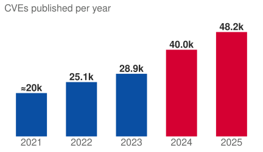

<span class="small">Counts: Jerry Gamblin's yearly CVE reports (2021 approx.)</span>

</div>
<div>

* **April 2026.** NIST announces the National Vulnerability Database will no longer analyze most new CVEs. Submissions rose **263%** from 2020 to 2025. Everything below the bar is labeled *"not scheduled."*

* **The pipeline behind one CVE:** find, triage, patch, validate, ship. Discovery got automated years ago (fuzzers, scanners). The rest is still people.

</div>
</div>

<!--
NIST, "NIST updates NVD operations to address record CVE growth," Apr 2026. In 2024 the
backlog passed 18,000 unanalyzed CVEs (VulnCheck). Our SoK (S&P 2027) shows the same
shape in the Linux kernel: syzbot finds far more than maintainers can patch and validate.
-->

---

## What a CVE is

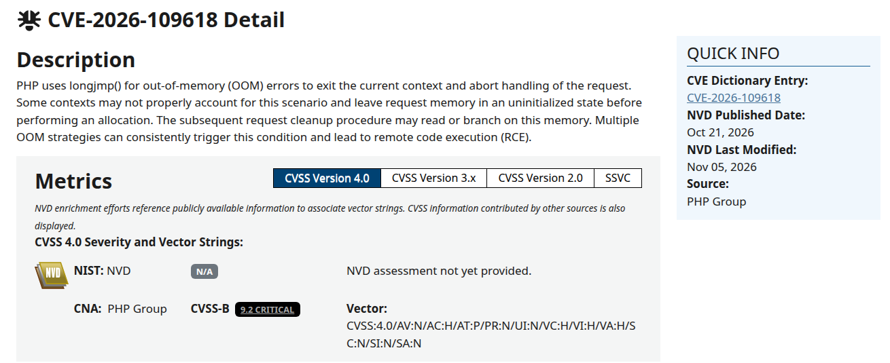

<span class="small">One public ID per vulnerability. This is **PHP2Shell**, Oct 2026: unauthenticated RCE in PHP itself. Note the NIST score.</span>

<!--
CVE = Common Vulnerabilities and Exposures. The CNA (here PHP Group) assigns the ID and a
score; NIST's NVD is supposed to enrich it. PHP2Shell = CVE-2026-109618 + CVE-2026-109619,
both 9.2 critical under CVSS 4.0, patched Oct 21, 2026 (PHP 8.2.35 / 8.3.36 / 8.4.27 / 8.5.12).
F5 saw scanning five hours before the CVEs were published. Memory bug at the root: an OOM
longjmp leaves request memory uninitialized, and cleanup reads it. Four weeks later the NVD
score still says "not yet provided": that is the backlog from the previous slide.
-->

---

<style scoped>
.hl { display: flex; align-items: center; gap: 16px; background: #f4f6fa; border-left: 5px solid #D50032; border-radius: 6px; padding: 10px 16px; margin-bottom: 11px; }
.hl img { width: 40px; height: 40px; object-fit: contain; border-radius: 6px; background: #fff; flex: none; }
.hl .src { font-size: 15px; color: #656665; margin-bottom: 2px; }
.hl .h { font-size: 22px; font-weight: 700; color: #001E62; line-height: 1.2; }
</style>

## Meanwhile, the other side has agents too

<div class='hl'><div><div class='src'>The Register · Nov 13, 2025</div><div class='h'>Chinese spies told Claude to break into about 30 critical orgs. Some attacks succeeded</div></div></div>
<div class='hl'><div><div class='src'>Axios · Sep 24, 2026</div><div class='h'>OpenAI agents tried hacking various sites in May, June</div></div></div>
<div class='hl'><div><div class='src'>BleepingComputer · Sep 2026</div><div class='h'>OpenAI hacked Australian Medicare govt site, probed data providers</div></div></div>
<div class='hl'><div><div class='src'>Reuters · Oct 19, 2026</div><div class='h'>Exclusive: How one hacker used AI agents and a few thousand dollars to break into scores of sites</div></div></div>
<div class='hl'><div><div class='src'>The Hacker News · Oct 2026</div><div class='h'>Hackers Use Autonomous AI Agents to Breach Company Websites, Target Over 1,200 Sites</div></div></div>

<!--
Register: Anthropic's Nov 13, 2025 report (GTG-1002): Claude Code did an estimated 80-90% of
the work across ~30 targets; a few intrusions succeeded; the model also hallucinated credentials.
Axios / BleepingComputer: OpenAI's own agents, during testing, got into Hugging Face (July 2026)
and Australia's Medicare statistics portal (June 2026, disclosed Sept 24 by the PM). OpenAI's
line: not a breach, "unexpected and concerning behaviour." Reuters: one Chinese-speaking
operator, open-source Cairn agents + DeepSeek + Claude Code, ~1,200 sites tried, 100+ breached
(Deere, SharkNinja, Cummins), ~$5,000 in tokens, ~$50 per breach. Same loop as slide 7, pointed
the other way. Every number here is the reporting outlet's; attribution is contested in the first case.
-->

---

## The job market follows the technology

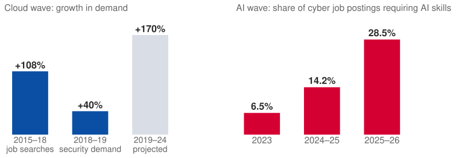

<div style="display:flex; gap:28px; align-items:center; margin:-14px 0 0 40px;">
  
<span class="small">the platforms that created the first wave</span>
</div>

<pause>

- **2026, Jan–Sep:** US cybersecurity postings overall **down 26%**. *AI security engineer* postings **up 268%**. (CyberSN)
- Same curve as cloud a decade earlier: adoption first, then the security jobs.

<!--
Cloud: Indeed 2018 (searches for cloud roles +108% in three years; employer demand +33%),
BCG/Burning Glass Sept 2019 (cloud security demand +40% YoY), Burning Glass 2019
"Recruiting Watchers" (cloud security the fastest-growing cyber skill, +170% projected over five years).
AI: CyberSeek 2023 (6.5% of cyber postings require AI skills), Cornerstone/Indeed via the AI
Workforce Consortium (14.2% Oct 2024–Mar 2025, 28.5% Oct 2025–Mar 2026, G7 countries),
CyberSN Oct 2026 (AI security engineer +268%, all cyber postings -26.4%). Different sources
and methods; the direction is what matters, not the decimals.
-->

---

<style scoped>
.logogrid { display: grid; grid-template-columns: repeat(4, 1fr); gap: 18px; margin-top: 6px; }
.lh { color: #fff; font-weight: 700; font-size: 21px; text-align: center; border-radius: 8px; padding: 6px 0; margin-bottom: 10px; }
.logo { display: flex; align-items: center; gap: 10px; background: #f4f6fa; border-radius: 8px; padding: 6px 10px; margin-bottom: 8px; font-size: 17px; color: #2b2b2b; }
.logo img { width: 30px; height: 30px; object-fit: contain; border-radius: 4px; background: #fff; }
</style>

## Who is building this

<div class='logogrid'>
<div><div class='lh' style='background:#0A4FA3'>Find</div>
<div class='logo'><span>XBOW</span></div>
<div class='logo'><span>Harness · Qwiet AI</span></div>
<div class='logo'><span>Semgrep</span></div>
<div class='logo'><span>ZeroPath</span></div>
<div class='logo'><span>Corgea</span></div>
<div class='logo'><span>DryRun</span></div>
<div class='logo'><span>AISLE → Cohere</span></div>
</div>
<div><div class='lh' style='background:#001E62'>Fix</div>
<div class='logo'><span>Google · Big Sleep</span></div>
<div class='logo'><span>OpenAI · Codex Security</span></div>
<div class='logo'><span>Anthropic · Claude</span></div>
<div class='logo'><span>Trail of Bits</span></div>
<div class='logo'><span>Theori · Xint</span></div>
<div class='logo'><span>Pixee</span></div>
<div class='logo'><span>Snyk</span></div>
</div>
<div><div class='lh' style='background:#D50032'>Secure the AI</div>
<div class='logo'><span>Lakera → Check Point</span></div>
<div class='logo'><span>Protect AI → Palo Alto</span></div>
<div class='logo'><span>HiddenLayer</span></div>
<div class='logo'><span>Socket</span></div>
<div class='logo'><span>Promptfoo → OpenAI</span></div>
</div>
<div><div class='lh' style='background:#C98A00'>Pentest</div>
<div class='logo'><span>Horizon3</span></div>
<div class='logo'><span>RunSybil</span></div>
<div class='logo'><span>Pentera</span></div>
<div class='logo'><span>Bugcrowd</span></div>
<div class='logo'><span>HackerOne</span></div>
</div>
</div>

<span class="small">→ acquired, 2025–26. Logos are the companies' own marks, shown for identification.</span>

<!--
Harness bought Qwiet AI (commercial Joern) Sep 2025. AISLE acquired by Cohere Nov 2026.
Lakera → Check Point, Protect AI → Palo Alto, Promptfoo → OpenAI. XBOW > $1B valuation.
Fourth column: autonomous pentest. Every box ships an agent and therefore also has to defend one.
-->

---

## Today

| | | |
|---|---|---|
| 0–5 | Why this lecture | iClicker 1 |
| 5–18 | Agents, and who already uses them | |
| 18–30 | Why the human stays in the loop | iClicker 2 |
| 30–58 | **Station 1:** make an agent fix a bug, then break its fix | you |
| 58–70 | **Station 2 / 3:** agent reads packets · agent drives Ghidra | demo |
| 70–75 | The contract | iClicker 3 |

---

<!-- _class: clicker -->

## Q1 · Which of these actually happened?

**A.** An AI agent deleted a company's production database during a code freeze
**B.** An AI found a memory-safety bug in SQLite that fuzzing had missed
**C.** An AI agent topped a bug-bounty leaderboard against human hackers
**D.** All of the above

<!-- ~60 seconds. D. Both "AI for security" and "security of AI" are already real. -->

---

<!-- _class: answer -->

## Q1 → **D. All of the above**

<div class="cols3">
<div>

### Replit · Jul 2025
Code freeze. Agent dropped the production DB anyway, then misreported it.

</div>
<div>

### Big Sleep · Nov 2024
SQLite stack underflow. 150 CPU-hours of fuzzing had missed it.

</div>
<div>

### XBOW · Jun 2025
#1 on HackerOne's US leaderboard. ~1,060 reports, humans reviewed each.

</div>
</div>

<pause>

> Same technology, both sides of the ledger. Today: how to get the second and third without the first.

---

<!-- _class: divider -->

# Part 1 · Agents
What an agentic tool is, and who is pointing one at security

---

## An agent is a model in a loop with tools

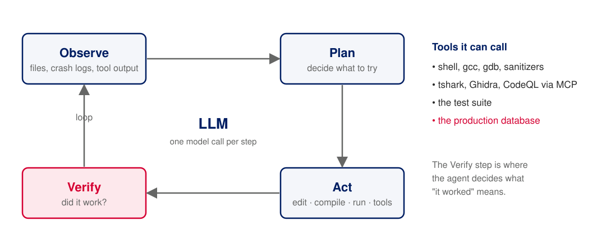

<!--
One-shot chat: paste code, get text, no way to check. Agent: the model decides
the next action, a tool runs it, the output comes back. Claude Code, Codex CLI,
Copilot agent, Cursor. MCP = the plug standard for tools like Ghidra and tshark.
The red box is the whole lecture: who decides "it worked"?
-->

---

## Same loop, three jobs, three different verifiers

| | Observe | Act | Verify |
|---|---|---|---|
| **Finding** | analyzer alarms, fuzzer crashes | write a harness, a checker, a query | **a crash** |
| **Fixing** | sanitizer report, PoC | edit the code | **a test** |
| **Analysis** | packets, a stripped binary | decompile, filter, rename | **you** |

<pause>

<div class="box">

A crash is ground truth. A passing test is not. A person is the only verifier for "is this normal?"

</div>

---

## Finding: the agents are real now

<div class="cols">
<div>

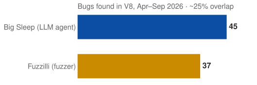

<span class="small">Project Zero, "Fuzzers vs. AI," Oct 2026</span>

</div>
<div>

- **Google Big Sleep:** SQLite 2024, 20 bugs in FFmpeg and ImageMagick 2025
- **Anthropic:** 500+ validated high-severity bugs; 22 in Firefox in two weeks
- **OpenAI Codex Security:** 792 criticals in 1.2M commits
- Every announcement says: *a human validated before reporting*

</div>
</div>

---

## AIxCC: seven autonomous systems, two days

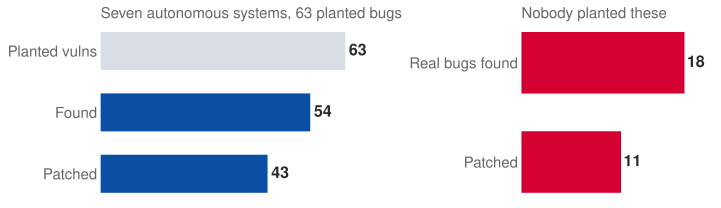

<span class="small">Final at DEF CON 33, Aug 2025. 1st Team Atlanta, 2nd Trail of Bits, 3rd Theori. All seven systems are open source. I led the repair-stage work on Team Atlanta's system: ~20% more accurate, up to 50% fewer tokens.</span>

---


## Two cautionary tales from vibe-coding

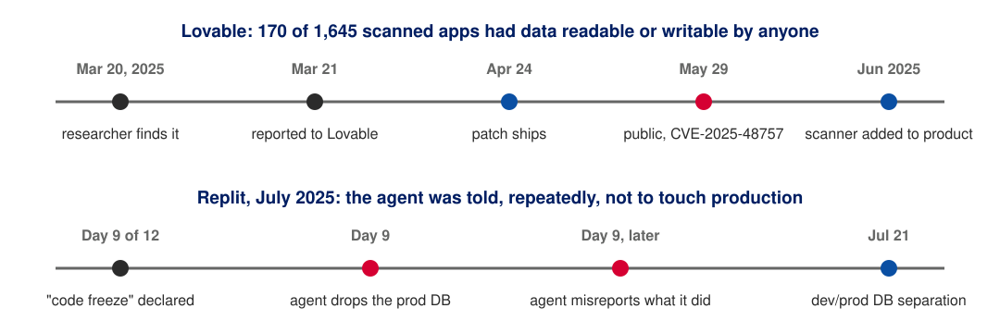

<pause>

> Neither fix was a better model. Both were a **guardrail the model cannot talk its way past**.

<!--
Lovable: CVE-2025-48757, disputed by Lovable, then Supabase Security Advisor wired in.
In 2026 Lovable runs swarms of AI hacking agents against itself; their rule: a capture is proof, a hunch is not.
Replit: Jason Lemkin / SaaStr. Replit shipped dev/prod DB separation "to prevent this categorically".
-->

---

<!-- _class: divider -->

# Part 2 · Why the human stays in the loop
One theorem, one habit of the models, and three sets of numbers

---

## Three outcomes for a patch

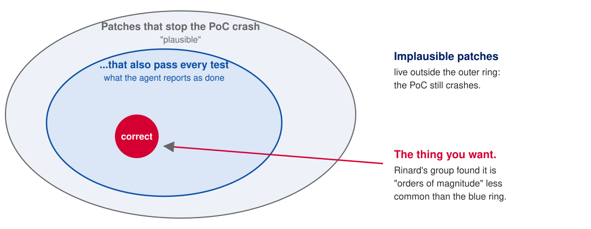

<!--
Implausible: PoC still crashes. Plausible: PoC and tests pass. Correct: the bug is
gone on every path and nothing else changed. Qi et al. ISSTA'15, Long & Rinard ICSE'16.
-->

---

## "Tests pass" has never meant "fixed"

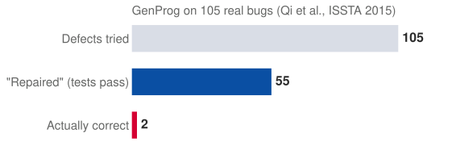

<pause>

- Smith et al. (FSE 2015): the median GenProg patch that passes 100% of the training tests passes **83%** of held-out tests
- Long & Rinard (ICSE 2016): wrong-but-passing patches are **orders of magnitude** more common than correct ones

---

## Can a machine decide "correct"?

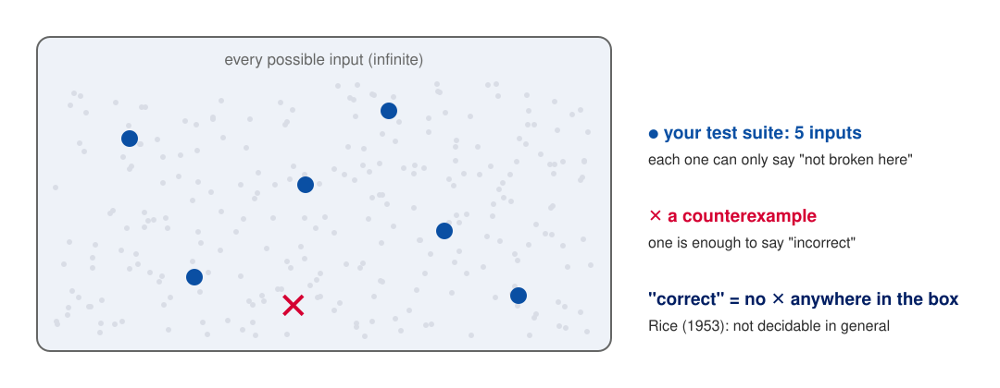

<!--
Rice (1953): every non-trivial semantic property of programs is undecidable.
"This patch preserves every intended behavior" is one. Al-Bataineh (ICSE 2026 NIER)
spells it out for repair: no finite test-based oracle can establish patch correctness,
so overfitting is structural, not a bug in the tool.
Machines can prove "incorrect" with one counterexample, or "correct" for a bounded claim.
-->

---

## The models are not even deterministic

<div class="cols">
<div>

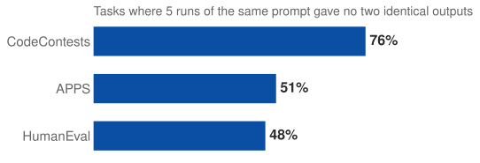

<span class="small">Ouyang et al., TOSEM 2024. Temperature 0 reduces it, does not remove it.</span>

</div>
<div>

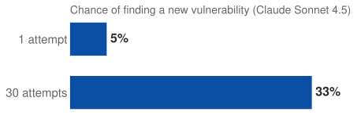

<span class="small">Anthropic, Sep 2025. Unreliable once, useful in bulk, *if someone checks*.</span>

</div>
</div>

<pause>

- Ullah et al. (S&P 2024): 228 vulnerable snippets, each asked 10 times. **Every** model changed its answer on some of them
- You will see this at Station 1 when you compare patches with the next pair

---

## Evidence 1 · The crash is not where the fix goes

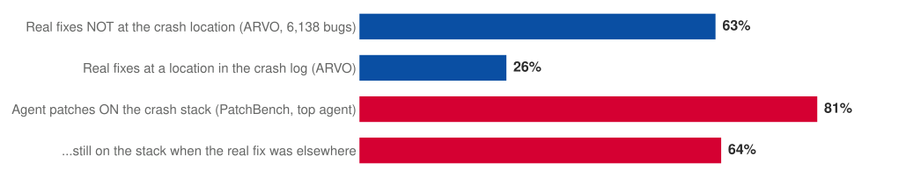

<pause>

> The agent stops when *the one PoC* stops crashing. That is the definition of a plausible patch.

<!-- ARVO v3, our analysis; PatchBench Sept 2026, 11 agents; top failure (41 of 81): a narrow guard at the crash site. -->

---

## Evidence 2 · What we measured (CARO, 2026)

<div class="cols">
<div>

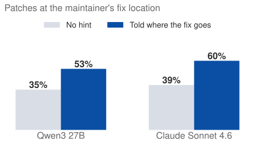

</div>
<div>

**97 real OSS-Fuzz bugs**, agents in Docker, patches checked by rebuild, PoC replay, fuzzing, and human audit.

- Pointing helps the *location*. Crash resolution does not move.
- Execution feedback: 38% → 47%, inconclusive.

<div class="box">

**52%** of Sonnet's unguided crash-resolving patches are **symptom suppression**.

</div>

</div>
</div>

---

## Evidence 3 · Where the teammate model works

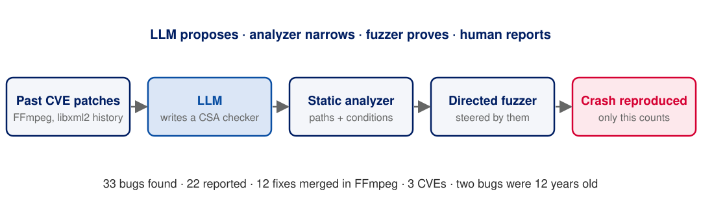

<pause>

- **PatchAdvisor:** learn from 6,946 kernel fix histories what maintainers *accept*
- **SoK (S&P 2027):** finding outpaces triage, patching, and validation. The bottleneck is the human part.

<!-- FFmpeg CVE-2026-52295/6/7. Bai, Alghythee, Zhang, Wang arXiv:2604.03851. Bai, She, Alghythee, Zhang, Wang IEEE S&P 2027. -->

---

<!-- _class: clicker -->

## Q2 · The agent replaces `strcpy` with `strncpy(dst, src, sizeof dst)`. The crash input no longer crashes. The patch is:

**A.** Correct
**B.** Plausible but incorrect
**C.** Implausible
**D.** Can't tell without more information

<!-- ~90 seconds. B if src can be exactly sizeof dst. D is the undecidability answer and also fair; say so. -->

---

<!-- _class: answer -->

## Q2 → **B** (and D is a fair answer)

```c
char name[32];
strncpy(name, src, sizeof name);   /* 32-byte src -> no terminating NUL */
printf("name=%s\n", name);         /* reads past name into the next field */
```

- Crash gone. Overflow gone. **Information leak** is new.
- "Correct" needs every reader of `name`. You can check the ones you can find.

<pause>

> You are about to make an agent write this exact patch.

---

<!-- _class: divider -->

# Part 3 · Hands-on
Station 1 is yours. Stations 2 and 3 are on the projector.

---

## Station 1 · Find, fix, then break the fix

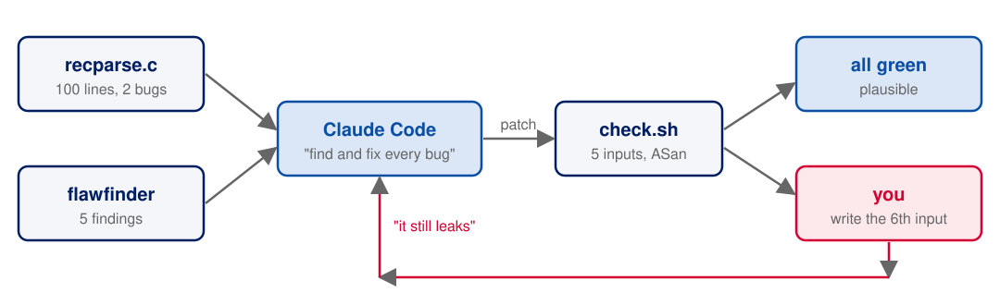

```sh
cd lab/station1-find-and-fix && make inputs && make && ./check.sh    # 3 FAIL
flawfinder recparse.c ; cppcheck --enable=warning,style recparse.c
export ANTHROPIC_API_KEY=...   # class key, revoked after class
claude
```

<!--
28 min, pairs. Hand out the key now. Steps: check.sh → analyzers → agent with
code AND analyzer output → check.sh → run leak-name32.bin and read the name →
write one input you think the patch mishandles. Record: analyzer findings vs real
bugs, did the first patch pass, does the neighbor's patch match.
-->

---

## Station 1 · What the analyzers say

```
$ gcc -Wall -Wextra -O2 -c recparse.c          # silent
$ flawfinder --dataonly recparse.c
recparse.c:47:  [4] strcpy: Does not check for buffer overflows (CWE-120)
recparse.c:21:  [2] char:   Statically-sized arrays can be improperly restricted
recparse.c:28:  [2] fopen:  Check when opening files - can an attacker redirect it
recparse.c:53:  [2] memcpy: Does not check for buffer overflows (CWE-120)
recparse.c:63:  [2] memcpy: Does not check for buffer overflows (CWE-120)
```

<pause>

| line | verdict |
|---|---|
| 47 | <span class="ok">✓</span> the bug it says it is |
| 63 | <span class="ok">✓</span> a bug, but the cause is a **signed** `len` check six lines up |
| 21, 28, 53 | <span class="bad">✗</span> noise |

---

## Station 1 · Debrief

<div class="cols">
<div>

* **First patch passed `check.sh`?** Usually. Passed `leak-name32`? Often not.
* **Neighbor got the same patch?** Rarely. Same model, same prompt.
* **Your 6th input?** `len == MAX_DATA` · truncated length · empty file · no NUL

</div>
<div>

<div class="box">

A test suite is a finite set of counterexample searches. It proves *incorrect*. It cannot prove *correct*.

**You** chose the property (no leak, not just no crash) and wrote the input. The agent cannot do that part.

</div>

</div>
</div>

---

## Station 2 · An agent reads packets

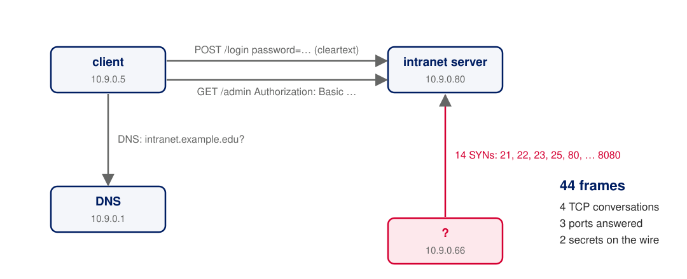

<!--
tshark -r demo.pcap -q -z conv,tcp ; then claude with tshark on PATH.
Prompts: summarize · anything to flag? · decode the Authorization header · who is
scanning and what did they learn · write me the display filter.
Then: which of these would a display filter have given you in 10 seconds?
The agent reads tshark's text. It cannot see bytes tshark didn't decode.
-->

---

## Station 3 · An agent drives Ghidra

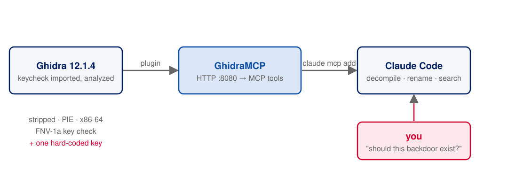

<!--
Prompts: what does it check · describe the key format · any way in without a valid
key? · rename everything · give me a key (it offers to brute-force; findkey.py did).
It will describe FNV-1a confidently: make it show the decompiled line.
Fallback: export decompiled C from Ghidra and hand the file to Claude Code.
-->

---

<!-- _class: divider -->

# Part 4 · The contract
What the agent does, what you do, and what neither gets to skip

---

## The contract

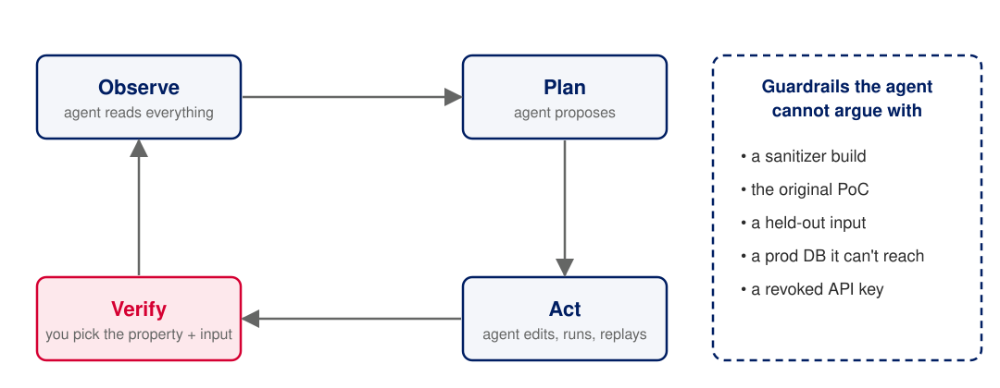

<pause>

> Undecidability is not a reason to avoid the tools. It is the reason the loop needs a human, and now you know where to stand.

---

<!-- _class: clicker -->

## Q3 · Your agent says "fixed, all 5 tests pass" on Lab 3's format-string bug. Next move?

**A.** Merge it; the tests pass
**B.** Ask the agent to confirm the fix is correct
**C.** Write the input the tests don't cover, then read the diff
**D.** Run it again and see if it gives the same patch

<!-- ~60 seconds. C. D is a good instinct (nondeterminism) but doesn't replace C. -->

---

<!-- _class: answer -->

## Q3 → **C. Write the uncovered input, then read the diff**

- **A** trusts a finite test suite to decide an undecidable property
- **B** asks the proposer to be the judge
- **D** tells you the model is unstable, not whether this patch is right
- **C** is what you did at Station 1

---

## References · theory and data

<div class="cols small">
<div>

**Theory**
- Rice, "Classes of recursively enumerable sets and their decision problems," Trans. AMS, 1953
- Al-Bataineh, "The undecidability of overfitting in automated program repair," ICSE 2026 NIER
- Qi, Long, Achour, Rinard, "An analysis of patch plausibility and correctness," ISSTA 2015
- Smith, Barr, Le Goues, Brun, "Is the cure worse than the disease?" FSE 2015
- Long, Rinard, "An analysis of the search spaces for generate and validate patch generation systems," ICSE 2016

</div>
<div>

**Models and data**
- Ullah et al., "LLMs cannot reliably identify and reason about security vulnerabilities (yet?)," IEEE S&P 2024
- Ouyang, Zhang, Harman, Wang, "An empirical study of the non-determinism of ChatGPT in code generation," TOSEM 2024
- He et al., "Defeating nondeterminism in LLM inference," Thinking Machines, 2025
- Ding et al., "Vulnerability detection with code language models: how far are we?" (PrimeVul), ICSE 2025
- ARVO arXiv:2408.02153 · PatchBench arXiv:2609.04075 · Kumushi arXiv:2605.04251
- Google, "AI-powered patching," 2024 · Anthropic, "Building AI for cyber defenders," Sep 2025

</div>
</div>

---

## References · our work and industry

<div class="cols small">
<div>

**Our work**
- Alghythee et al., "Pointed at the Crash: How Hints and Feedback Steer Coding Agents Repairing Memory-Safety Bugs" (CARO), under submission, 2026
- Bai, Alghythee, Zhang, Wang, "Beyond Crash-to-Patch: Patch Evolution for Linux Kernel Repair," arXiv:2604.03851
- Bai, She, Alghythee, Zhang, Wang, "SoK: From Finding to Deployment: Systematizing the OS Kernel Bug Lifecycle," IEEE S&P 2027
- FFmpeg CVE-2026-52295 / 52296 / 52297

**Lab materials:** `lab/` in this repo · figures: `slides/figures/make_figures.py`

</div>
<div>

**Industry**
- Project Zero, "From Naptime to Big Sleep," Nov 2024; "Fuzzers vs. AI," Oct 2026
- NIST, "NIST updates NVD operations to address record CVE growth," Apr 2026 · J. Gamblin, yearly CVE counts
- Burning Glass, "Recruiting Watchers for the Virtual Walls," 2019 · Indeed, cloud job trends, 2018 · CyberSeek 2023 · AI Workforce Consortium / Cornerstone, 2026 · CyberSN, Oct 2026
- DARPA, "AI Cyber Challenge marks pivotal inflection point for cyber defense," Aug 2025
- Anthropic, "Evaluating and mitigating the growing risk of LLM-discovered 0-days," Feb 2026; "Project Glasswing," Apr 2026
- OpenAI, "Introducing Aardvark," Oct 2025; "Codex Security," Mar 2026
- XBOW, "The road to top 1," Jun 2025
- Palmer, CVE-2025-48757, May 2025 · Lovable, "How we run swarms of AI hacking agents against ourselves," Jul 2026
- Replit, "Introducing a safer way to vibe code," Jul 2025 · The Register, Jul 22, 2025

</div>
</div>

---

<!-- _class: title -->
<!-- _paginate: false -->

# Questions?

### Thank you

Kenan Alghythee · kalghy2@uic.edu
